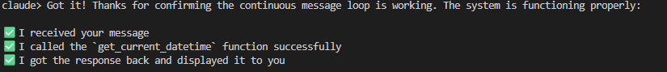

This project is to create a reminder with Claude via tool use.

The language of choice is C#, this is for learning purposes. I am most comfortable with TypeScript, and I believe it provides me with a good launchpad to pick up C#. 

## Current state of things


## The loop
```text
User: "Remind me 3 days after April 3, 2025 to call the dentist"
  │
  ▼
[you] client.messages.create(model, messages, tools=ToolSchemas.All)
  │
  ▼
Claude sees:  tools = [ add_duration_to_datetime {input_schema...}, set_reminder {...} ]
  │
  ▼
Claude returns:  stop_reason = "tool_use"
  content = [
    { type: "tool_use", name: "add_duration_to_datetime",
      input: { datetime_str: "2025-04-03", duration: 3, unit: "days" },
      id: "toolu_01..." }
  ]
  │
  ▼
[you] look up name → call Tools.AddDurationToDatetime("2025-04-03", 3, "days")
  → DurationResult.Ok(2025-04-06)
  │
  ▼
[you] send back:
  messages += { role: "user", content: [
      { type: "tool_result", tool_use_id: "toolu_01...",
        content: "New datetime: Sunday, April 06, 2025 12:00:00 AM" }
  ]}
  │
  ▼
Claude now knows the answer, emits second tool_use: set_reminder(content, timestamp)
  ... loop again ...
  │
  ▼
Claude emits final text: "I've set a reminder for April 6."
```